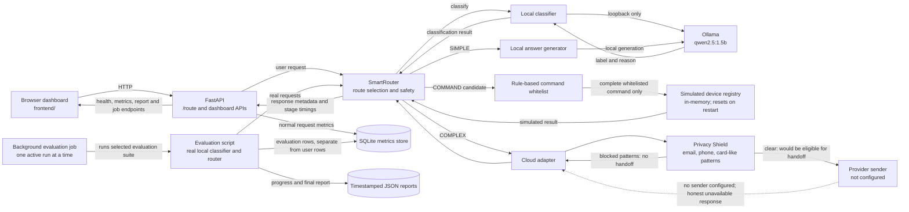

# Smart AI Router architecture

## Notes

- The classifier is configured for the loopback Ollama service and does not use an external LLM API for classification.
- The router uses the model label together with the rule-based parser. A command is not executed solely because the classifier returned `COMMAND`.
- The Privacy Shield is a local pattern check on the cloud path. It can miss sensitive formats.
- The cloud adapter has no configured provider sender in this project. A cloud-selected request therefore returns an unavailable result rather than a fabricated answer.
- Command outcomes update simulated in-memory state only. They do not control physical devices, and the state resets on server restart.
- SQLite stores metrics and evaluation aggregates without request text. Evaluation reports are written as JSON under `data/` (timestamped job runs are kept separately under `data/evaluation_runs/`).
